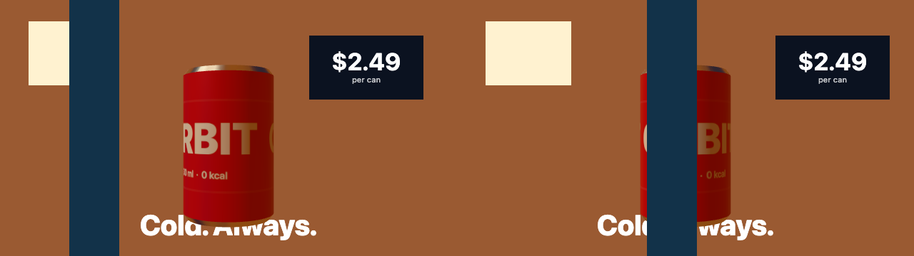
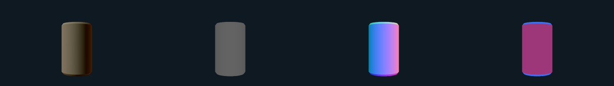
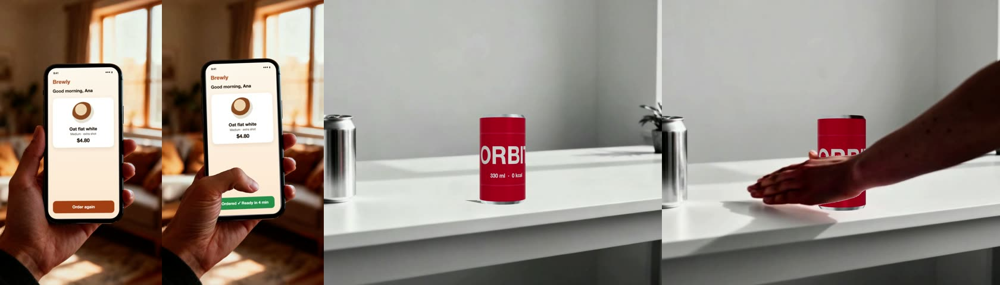

# Hybrid scenes: code inside footage

A hybrid scene combines two kinds of picture in one shot:

- **Footage** (a "plate"): filmed, or made by a video model. It supplies what only has to look real: people, places, weather, light.
- **Code**: it supplies what has to be exactly right: the product's shape and label, a price, an interface, a chart, a logo, a caption.

Stacking one on top of the other is easy and already worked. This document covers the harder case, where the two must agree with each other: a hand passes in front of a code-rendered product, a headline sits behind a presenter, a price stays stuck to a moving sign, the product is lit by the room it stands in.



*The hybrid starter, frames 7 and 34. The plate is a synthetic diagnostic pattern, not footage. The can, its label, the price screen and the headline are code.*

## Goal

Make a code-rendered element belong to the footage it is placed in, while keeping what EditableFrames is for: the code part stays an editable document. Changing the label, the price or the language re-renders the same frames with only that change. Nothing is regenerated and the footage is not touched.

EditableFrames does not run any model. Mattes, depth maps, tracks and camera paths are **inputs**. You make them with whatever tool you trust and license, and EditableFrames pins them, checks them and draws with them. This keeps the framework model-neutral and keeps export deterministic: the same inputs give the same frames.

## Video creation journeys

Each journey says what the author does, what EditableFrames does, and how far it is proven.

| # | Journey | The author supplies | EditableFrames does | Proven by |
|---|---|---|---|---|
| 1 | **A product in a generated place.** A hard-surface product sits in a scene made by a video model and takes on its light. | The plate. | Wraps the plate into an environment, estimates which side the light is on, and lights the product with both. Lighting from the plate is an editable, undoable control. | Integration test: the lit side follows the bright area, the colour follows the plate, toggling it changes only the product. |
| 2 | **Something in the footage passes in front of the product.** A hand, a person, a pillar. | The plate and a depth map of it. | Writes the plate's depth into the depth buffer, so every mesh is hidden exactly where the footage is nearer. | Integration test: the product is covered by the plate foreground and visible beside it. |
| 3 | **A headline behind the presenter.** Text or graphics sit between the subject and the background. | The plate and a matte of the subject. | Redraws the matted subject over the DOM layers. | Integration test: no headline pixel survives in front of the subject, and the text continues on both sides. |
| 4 | **Screen or label replacement.** An exact interface, price or label sits on a surface that moves in the footage. | The plate and a planar track of the surface. | Pins a DOM element to the tracked quad on every frame, including between frames. | Integration test: the element covers the tracked surface edge to edge as it moves. |
| 5 | **Code first, footage second.** The code scene sets the camera and blocking; a video model paints a world around it; the exact product goes back on top. | A scene that declares control passes. | Exports the scene as clay, depth, normal, object-id and matte passes from the same camera and timing. | Integration test for the passes. Sending them to a video model and compositing the result is outside this repository and unproven here. |
| 6 | **Many versions from one take.** The same shot in twenty prices, five languages, three label colours. | One plate and its data, then control edits. | Re-renders each version from the same pinned inputs. If the plate is replaced, its old matte, depth and track are refused instead of being composited slightly wrong. | Integration test for the refusals; edits use the existing revision-checked history. |
| 7 | **Fast motion.** Code elements that move quickly should smear like the footage does. | A shutter angle. | Renders several sub-frame samples per output frame and averages them. | Integration test: smear width and edge colour. |
| 8 | **A moving camera.** The product stays put in a shot whose camera travels. | A camera path solved elsewhere. | Replays the path on a Three.js camera, with rotation interpolated correctly. | Unit tests only. Not yet tried on a real solve; solves of generated footage are approximate. |

The integration tests use a synthetic plate. [On generated footage](#on-generated-footage) says what a trial on plates from video models found.

## Try it

```sh
node bin/editableframes.mjs init ./my-hybrid --hybrid
node bin/editableframes.mjs preview ./my-hybrid
node bin/editableframes.mjs render ./my-hybrid ./hybrid.mp4
node bin/editableframes.mjs render ./my-hybrid ./hybrid-blur.mp4 --motion-blur 180
node bin/editableframes.mjs render ./my-hybrid ./clay --format png --pass clay
```

The starter generates its own plate, matte, depth map and track with FFmpeg from one set of formulas, so tests can state where every pixel must land. Replace them with your own:

```sh
node bin/editableframes.mjs asset-add ./my-hybrid shot ./shot.mp4
node bin/editableframes.mjs asset-add ./my-hybrid shot-matte ./shot-matte.mp4 --role matte --of shot
node bin/editableframes.mjs asset-add ./my-hybrid shot-depth ./shot-depth.mp4 --role depth --of shot --depth inverse --near 1 --far 20
node bin/editableframes.mjs asset-add ./my-hybrid shot-track ./shot-track.json --role track --of shot
node bin/editableframes.mjs rebind ./my-hybrid
```

## Layers

Back to front, this order is right for most shots:

1. **Plate.**
2. **Far DOM**: screens pinned to surfaces in the background; text that passes behind the subject.
3. **Cut-out**: the plate's subject again (plate × matte), which restores it over layer 2.
4. **3D canvas**, depth-tested against the plate's depth. Depth decides per pixel whether the subject or the object is in front, so the canvas can sit above the cut-out.
5. **Near DOM**: captions, calls to action, logos.

A scene can draw all five itself, as the starter does. That keeps one clock and one set of inputs. Depth ordering between separate clips is not available: clips stack with a transform and opacity only.

## Plate data

Data computed from a plate is declared in `assets.json` as a **derived** asset. It records the hash of the plate it was computed from:

```json
"shot-matte": {"src": "assets/…mp4", "type": "video", "sha256": "…",
  "derived": {"of": "shot", "role": "matte", "sourceSha256": "<shot's sha256>"}}
```

`asset-add --role … --of …` writes this for you.

| Role | Type | Meaning |
|---|---|---|
| `matte` | video or image | White keeps the subject, black drops it. Luminance is coverage. |
| `depth` | video or image | Distance from the camera. White is near. Needs an `encoding` (below). |
| `normals` | video or image | Camera-space normals, `(n + 1) / 2` in RGB. Accepted and pinned; no helper consumes it yet. |
| `track` | data (JSON) | A planar or point track. See `packages/plate/track.mjs`. |
| `camera` | data (JSON) | A camera path. See `packages/plate/camera.mjs`. |
| `environment` | image | An equirectangular picture of the plate's surroundings. Accepted and pinned; the starter does not use one. |

Rules, each refused with a message that says what to do:

- The plate's hash must equal `sourceSha256`. A regenerated take invalidates its derived data.
- A plate has at most one asset per role.
- A derived asset cannot derive from another derived asset.
- A derived video must have exactly as many frames as its plate.
- A depth asset must carry an encoding. Tracks and camera paths are validated when loaded.

**Conforming data from other tools.** A derived video is read by frame number: frame 40 of a matte describes frame 40 of the plate. Tools do not always return that.

- *Fewer frames at the plate's own rate* means frames were dropped, usually at the end. Keep the frames where they are and hold the last one (or trim the plate). Stretching the video over the plate's length moves every frame in time; a depth map stretched from 112 to 121 frames ran up to five frames early.
- *Another frame rate* has to be resampled onto the plate's frame times.
- *A depth video must be grey.* Several hosted depth models return a false-colour picture. Ask for grayscale output, or map the colours back to values before importing.
- Check the result against something that moves: compare a moving edge in the plate with the same edge in the matte or depth map at a few frames.

**Depth encoding** is `{kind, near, far, packing}`. `kind` is `inverse` (what monocular depth models emit; precision is spent close to the camera) or `linear`. `near` and `far` are the distances white and black stand for, in scene units. `packing` is `gray8`, or `rg16` for 16 bits across red and green. Relative depth has no true scale, so `near` and `far` are values you tune until occlusion lands. They are not measurements.

**Track** files are `{version: 1, kind: "planar" | "point", width, height, frameRate: {num, den}, frames: [{frame, quad | point, confidence?}]}`. Coordinates are plate pixels from the top-left. Quads are ordered top-left, top-right, bottom-right, bottom-left. Frames may be sparse; samples between them are interpolated, and samples outside them hold the nearest frame and say so.

**Camera path** files are `{version: 1, frameRate, frames: [{frame, position, quaternion, fovY}]}`: camera-to-world, +Y up, looking down −Z, `fovY` in degrees.

## Renderer contract additions

Two optional services join `asset` and `mediaFrame`. Check that they exist before using them.

- `context.mediaInfo(id)` returns `{type, width, height, duration, frames, frameRate, derived}` for a declared asset.
- `context.derived(id, role)` returns the id of the asset derived from `id` with that role, or `undefined`.

`mediaFrame(id, seconds)` serves matte and depth frames like any other video. `asset(id)` returns a URL for a data asset; fetch it and parse the JSON.

A scene may declare **control passes**:

```js
defineRenderer({ …, passes: ['clay', 'depth', 'normal', 'id', 'matte'], … })
```



*Clay, depth, normal and object-id passes of the starter, exported with `render --pass`.*

The host then supplies `clock.pass` (`'beauty'` unless a pass was requested). A host never asks for a pass the scene did not declare, and the CLI refuses one. Pass names are open, like renderer names. `beauty` is implied and cannot be declared.

## Helpers

`editableframes/plate` is pure and renderer-independent:

| Area | Functions |
|---|---|
| Corner pin | `solveHomography`, `applyHomography`, `invertHomography`, `cornerPinTransform`, `cssMatrix3d`, `quadArea` |
| Tracks | `validateTrack`, `sampleTrack`, `scalePoints` |
| Camera | `validateCameraPath`, `sampleCameraPath`, `slerp` |
| Frame rate | `plateFrameIndex`, `conformSeconds`, `cadence` |
| Depth | `validateDepthEncoding`, `decodeDepth`, `encodeDepth`, `packDepth`, `unpackDepth`, `depthGlsl`, `unprojectDepth`, `fitGroundPlane` |
| Measuring a plate | `plateStats`, `matchLevels`, `applyLevels`, `estimateKeyLight`, `estimateNoise`, `grainAt`, `expandHighlights` |
| Passes | `idColor`, `idFromColor`, `validatePasses` |
| Canvas | `drawCutout`, `drawGrain`, `createFrameLoader` |
| Shutter | `shutterSamples`, `validateShutter` |

`editableframes/three-plate` is an optional Three.js adapter:

| Function | Purpose |
|---|---|
| `createDepthOccluder(encoding)` | Lets the plate's own geometry hide the scene. Needs WebGL2, a perspective camera and the standard depth buffer. |
| `createMatteHoldout()` | Punches the matted subject out of the canvas. The cheap alternative when there is no depth; it is all-or-nothing per pixel. |
| `createPlateEnvironment(renderer)` | Lights the scene with the plate. |
| `paintPlatePanorama(context, source, width)` | The panorama `createPlateEnvironment` builds: the plate in front of the camera, mirrored behind it. |
| `applyKeyLight(light, estimate)` | Aims a directional light from `estimateKeyLight`. |
| `applyCameraSample(camera, sample)` | Replays a camera path. |
| `createShadowCatcher(plane)` | An invisible plane that shows only shadows, laid on a plane from `fitGroundPlane`. |
| `renderPass(renderer, scene, camera, pass, options)` | Draws the scene as clay, depth, normal, id or matte. |
| `dataTexture(image)` | A texture for plate data with no colour management. |

None of this narrows what a renderer may draw. A scene that uses other libraries can read the same assets and implement its own passes.

## What is estimated, and how far to trust it

Three helpers guess from a single view. Expose their results as controls.

- **`estimateKeyLight`** reads which side the light is on from the brightest 5% of the frame. A picture cannot say how far in front of or behind the subject the light is, so that part is a stated assumption: a small source is placed level with the subject, a broad one in front of it. The brightest area is not always the light: a white desk under a window reads as light from below, and a low sun behind the subject reads as light from the front. A shadow cast from the estimate then falls the wrong way, so let the author set the direction.
- **`createPlateEnvironment`** has only what the camera saw. It puts the plate in front and a mirrored copy behind the camera, and pushes clipped highlights above 1 so they can act as light sources. The result is plausible. It is not a measurement of the real surroundings, and the highlight boost is not recovered data. Use a real `environment` asset when you have one.
- **Depth `near` and `far`** are yours to tune, as above.

## Frame rate

Video models emit a fixed rate: commonly 24 fps, sometimes 16 or 30. Two things follow.

- Anything locked to the footage should move on the footage's frame grid. `conformSeconds(seconds, plate.frameRate)` gives the time of the plate frame on screen; sample tracks, mattes and depth at that time. Otherwise a pinned element slides against the picture between plate frames.
- A plate inside a timeline of another rate repeats frames unevenly. `cadence({num: 24, den: 1}, {num: 30, den: 1})` reports the pattern `2,1,1,1`, which is visible as judder on any move. Render the project at the plate's rate, or interpolate the plate before importing it.

## Export

- `render DIR OUT --pass NAME` renders a declared pass. The receipt records it.
- `render DIR OUT --motion-blur ANGLE [--samples N]` opens a shutter of `ANGLE` degrees (0–360, default samples 8, range 2–64) centred on each frame. Samples are averaged as premultiplied colour, so a half-covered pixel keeps its hue. The mean is taken on encoded values, not linear light. Preview shows no motion blur.
- An export re-encodes its inputs. Content credentials or other provenance metadata carried by a generated plate are not copied to the output. If a law or a platform requires you to disclose AI-generated content, that remains your responsibility.

## Compared with a full compositing checklist

Professional compositing uses more steps than this. Stated plainly:

| Step | Status |
|---|---|
| Occlusion by plate geometry | Done, from a depth map. |
| Subject in front of graphics | Done, from a matte. |
| Planar tracking and corner pin | Drawing done, for flat surfaces. The track comes from another tool. A surface that bends (curled paper, cloth) needs a mesh warp, which is not provided. |
| Edge clean-up of the cut-out | Not provided. A matte edge keeps some of the plate's background colour, which shows as a thin fringe over contrasting graphics. |
| Reflections of the plate in the object | Approximated by `createPlateEnvironment`. |
| Light direction | Estimated; editable. |
| Black and white point match | Measured by `plateStats` / `matchLevels`. Applying it is left to the scene. |
| Grain match | Measured by `estimateNoise`; `drawGrain` adds seeded grain. Not applied by the starter. |
| Motion blur | Done at export, for code layers. |
| Shadow of the object on the plate | `fitGroundPlane` and `createShadowCatcher` exist. Not exercised by the starter or the integration test. |
| Camera match | Replay only. No solver. |
| Depth of field, lens distortion, chromatic aberration, light wrap, atmospheric haze | Not provided. |
| Reflection or shadow of the object in the plate's own surfaces | Not provided. It needs the plate's normals and roughness. |
| Linear-light compositing | Not provided. Layers are composited by the browser on encoded values. |

## On generated footage

The helpers were tried on twelve 5–6 second plates from four video models (Seedance 1 Pro Fast, Kling 2.5 Turbo Pro, Veo 3.1 Fast, Wan 2.2), with mattes and depth maps from hosted models and tracks from a classical planar tracker. Each scene was a renderer scene of the kind the starter shows. This is one trial, not a benchmark.



*Generated plates with code inside them. Left: an HTML screen pinned to a tracked phone; the thumb is the plate's, cut out again from a matte. Right: a code-rendered can beside the plate's own can; the arm hides it where the plate's depth map is nearer.*

| Journey | What was found |
|---|---|
| Screen or label on a surface | Holds on rigid surfaces. A screen pinned to a phone in a moving hand stayed within 3 px of where it started on the screen, at 1088 × 1920, while the phone moved 24 px. A sheet of paper that curled is not a plane: with all four corners right, its edges missed the pin by up to 15 px. |
| Headline behind a subject | Works with a hosted matte. Hair over dark letters shows a 1–2 px light fringe. |
| Footage in front of a 3D object | Works once `near` and `far` are tuned by eye. The edge is as rough as the depth map's own edge, a few pixels. A depth model that normalises each frame separately changes an object's value when something new enters the shot; prefer one that is consistent over time. |
| Lit by the footage | The plate's colour carries over. Under strongly coloured light a bare metal object takes too much of it (aluminium read as brass in a warm kitchen). `estimateKeyLight` chose the wrong side on two of three plates, as described above. |
| Placing a 3D object without a camera solve | A real stand-in object in the plate (a plain can), tracked as a plane, gave position and scale for a code object beside it through a slow push-in. It also shows what the plate's own light and shadow look like on that object. |

Two things made pinned graphics read as part of the surface: a `mix-blend-mode` chosen for the material (`screen` for chalk on a dark board, `multiply` for print on paper), and the plate's own frame rate for the whole project.

## Limits

- The plate, matte and depth are decoded to PNG frames before preview and export, within the existing 8 GiB budget. Three videos per shot use it three times as fast.
- A renderer scene has no audio port. Sound from footage inside a scene is not mixed; keep speech on a media-port clip.
- `createDepthOccluder` assumes the plate and the scene share one camera. A depth map from a monocular model is consistent with itself, not with your scene units.
- Antialiased edges mix values, so `id` and `depth` passes are exact only away from silhouettes. `renderPass` does not handle skinned or instanced meshes.
- Results differ slightly across GPUs and browsers, as elsewhere in this framework.
- The tests use a synthetic plate. They prove that pixels land where the inputs say. They do not prove that a particular matting, depth or tracking tool gives good inputs on real footage; the trial above is the only evidence of that so far.
